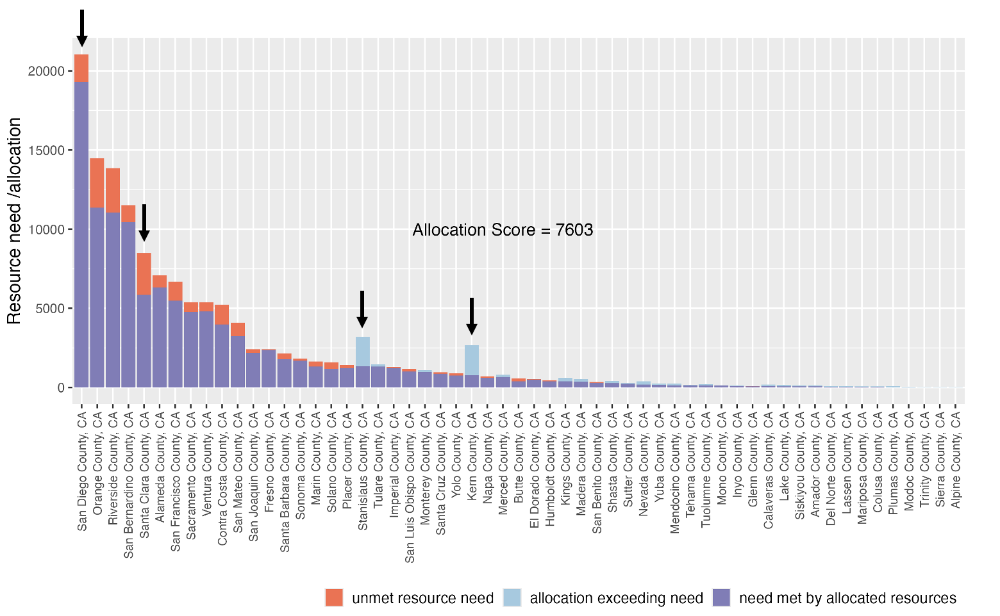

```{r message=FALSE, warning=FALSE, include=FALSE}

library(GGally)
library(targets)
library(knitr)
library(viridis)
library(kableExtra)
library(covidHubUtils)
library(ggh4x)
library(ggpmisc)
library(patchwork)
library(tidyverse)

options(digits=4, scipen = 999) 

```

```{r warning=FALSE, message=FALSE, include=FALSE, echo=FALSE}

### Read Data
tar_load("truth_data")
tar_load("forecast_data1wk")
tar_load("forecast_data3wk")
tar_load("alloscores1wk")
tar_load("alloscores3wk")
tar_load("percap1")
tar_load("percap3")
tar_load("baseline1")
tar_load("baseline3")
tar_load("resource_constraint_grid")
tar_load("score_data1wk")
tar_load("score_data3wk")

# Combine all datasets
### 1 week scores 
alloscores1wk <- alloscores1wk %>% mutate(horizon = 1)
percap1 <- percap1 %>% mutate(horizon = 1)
baseline1 <- baseline1 %>% mutate(horizon = 1)
### 3 week scores
alloscores3wk <- alloscores3wk %>% mutate(horizon = 3) %>%
  mutate(filterout = paste(model,target_end_date)) %>%     # CU-select only reporting for 56 counties in wk 3 of 12/18!
  dplyr::filter(filterout != "CU-select 2021-12-18") %>% select(-filterout)
percap3 <- percap3 %>% mutate(horizon = 3)
baseline3 <- baseline3 %>% mutate(horizon = 3)
## Bind
all_alloscores_data <- rbind(alloscores1wk, alloscores3wk, percap1, percap3, baseline1, baseline3)

# Merge with the ground truth counts to retrieve resource constraints
### Ground truth counts (= 'value' column of the grid)
resource_constraints <- resource_constraint_grid %>% select(target_end_date, value) 
### Merge all scores with ground truth, calculate % resource constraint, calculate avoidable underallocation ("components" of AS)
all_alloscores_data <- all_alloscores_data %>% merge(resource_constraints, by = "target_end_date") %>% 
  mutate(Constraint = as.character(K/value)) %>%
  mutate(filterout = paste(model,target_end_date, horizon)) %>%                       # CU-select - remove again for some reason
  dplyr::filter(filterout != "CU-select 2021-12-18 3") %>% select(-filterout) %>%
  mutate(components = case_when(               # This line gets rid of negatives by turning
    components < 0 ~  0,                       # neg values (undershoots) to absolute value 
    components >= 0 ~ abs(`components`)))      # and pos values (overshoots) to 0.


# Calculate 90% AS
### 90% alloscore = 0.90 constraint
all_alloscores_data90 <- all_alloscores_data %>% dplyr::filter(Constraint == 0.9)
### Sum individual components into scores (model + date + horizon); rank scores (date + horizon)
all_alloscores <- all_alloscores_data90 %>%
  group_by(model, target_end_date, horizon) %>%              # absolute value calculation already done above
  summarize(alloscore = sum(components), yobs = sum(y)) %>%
  group_by(target_end_date, horizon) %>%
  mutate(nmodels = n(),
         allo_rank = rank(alloscore, ties.method = "min"),
         allo_rank_std = 1- (allo_rank-1)/(nmodels-1)) %>%
  ungroup() %>%
  #complete(model, target_end_date) %>%
  mutate(target_end_date = as.Date(target_end_date)) %>% select(-nmodels)


# MWIS
alloscore_models <- unique(all_alloscores$model)
### Retrieve 1 week scores and rank (date)
score_data_summaries1 <- score_data1wk %>%
  dplyr::filter(model %in% alloscore_models) %>%
  group_by(model, target_end_date) %>%
  summarize(MWIS = mean(wis)) %>%
  ungroup() %>%
  group_by(target_end_date) %>%
  mutate(nmodels = n(),
         MWIS_rank = rank(MWIS, ties.method = "min"),
         MWIS_rank_std = 1- (MWIS_rank-1)/(nmodels-1)) %>%
  ungroup() %>%
  complete(model, target_end_date) %>% mutate(horizon = 1)
### Retrieve 3 week scores and rank (date)
score_data_summaries3 <- score_data3wk %>%
  dplyr::filter(model %in% alloscore_models) %>%
  group_by(model, target_end_date) %>%
  summarize(MWIS = mean(wis)) %>%
  ungroup() %>%
  group_by(target_end_date) %>%
  mutate(nmodels = n(),
         MWIS_rank = rank(MWIS, ties.method = "min"),
         MWIS_rank_std = 1- (MWIS_rank-1)/(nmodels-1)) %>%
  ungroup() %>%
  complete(model, target_end_date) %>% mutate(horizon = 3)
score_data_summaries <- rbind(score_data_summaries1, score_data_summaries3) %>% select(-nmodels)

# IAS and Weighted IAS
### Weights
kprobs <- resource_constraint_grid %>% 
  pivot_longer(!c(target_end_date, value), names_to = "number", values_to = "K") %>% 
  select(-number)
kprobs <- kprobs %>% group_by(target_end_date) %>% 
  mutate(sd1 = quantile(K, 0.975),
         sd2 = quantile(K, 0.025), 
         mean_k = quantile(K, 0.500),
         weight = dnorm(K, mean = mean_k, sd = (sd1-sd2)/4)/sum(dnorm(K, mean = mean_k, sd = (sd1-sd2)/4))) %>% 
  select(-value, -sd1, -sd2)

#### VISUALIZE WEIGHTS HERE
# kprobs %>% ggplot(aes(x=K, y=weight, group = target_end_date, color = target_end_date)) +
#   geom_point() +
#   geom_line() #+ scale_x_continuous(transform="log10")
# view(kprobs %>% group_by(target_end_date) %>% summarise(sum(weight)))

### Calculate AS (model + K + horizon + date), IAS uniform (model + horizon + date), IAS weighted (model + horizon + date), rank scores (horizon + date)
all_ias <- all_alloscores_data %>%
  group_by(model, K, horizon, target_end_date) %>%         # absolute value calculation already done above
  summarize(alloscore = sum(components)) %>%
  left_join(kprobs, by=c("target_end_date", "K")) %>%
  group_by(model, horizon, target_end_date) %>%
  summarize(IAS = mean(alloscore),
            IAS_wt = sum(alloscore*weight, na.rm=TRUE)) %>% ungroup() %>%
  group_by(horizon, target_end_date) %>%
  mutate(ias_rank = rank(IAS, ties.method = "min"),
         ias_wt_rank = rank(IAS_wt, ties.method = "min"),
         nmodels = n(),
         ias_rank_std = 1- (ias_rank-1)/(nmodels-1),
         ias_wt_rank_std = 1- (ias_wt_rank-1)/(nmodels-1)) %>% ungroup() %>% select(-nmodels)

# Combine all scores into big dataset
all_scores <- left_join(all_alloscores, score_data_summaries,
                        by=c("model", "target_end_date", "horizon")) 
all_scores <- left_join(all_scores, all_ias,
                        by=c("model", "target_end_date", "horizon")) 
```

------------------------------------------------------------------------

## Thank you to my coauthors...

- **Nicholas Reich, PhD** (University of Massachusetts, Amherst)

- **Lauren White, PhD** (California Department of Public Health)

- **Tomás León, PhD** (California Department of Public Health)

------------------------------------------------------------------------

## Contents

- Background
  - Forecasts and Use-Aware Forecast Evaluation
  - Allocation Score
  - Integrated Allocation Score
  - Weighted Interval Score
  - COVID-19 Forecasting Hub data
- Experimental Design
- Results
- Conclusions

# Background

## What do we use forecasts for?

{fig-align="center" width="100%"}

------------------------------------------------------------------------

## Possible Uses For Infectious Disease Forecasting

- Public-facing communications

- Situational Awareness

- Coordination of resources (ex. vaccines, medicines, hospital staffing)

- Advance warning for organizational/emergency activation

------------------------------------------------------------------------

## The Need for Use-Aware Forecast Evaluation

- Productive engagement between forecasters and practitioners requires that [models be created, evaluated, and improved upon with both the public health need and the priorities of the public health agency in mind.]{.underline}

- Forecast evaluation methods are [always]{.underline} grounded in assumptions of what constitutes a "best" model.

- Key in interpreting forecast scores:

  - *What does this scoring method assume?*

  - *What does it prioritize?*

  - *Therefore, what is this score saying?*

------------------------------------------------------------------------

## The Need for Use-Aware Forecast Evaluation


------------------------------------------------------------------------

## Overview of Scoring Methodologies for Probabilistic Forecasts

- With these priorities in mind, we will:

  - Introduce a recently-developed scoring rule, the Allocation Score (AS)

  - Introduce its extension, the Integrated Allocation Score (IAS)

  - Review the Weighted Interval Score (WIS), another commonly-used evaluation method for probabilistic forecasts.

- These 3 methods will be the focus of this analysis.

------------------------------------------------------------------------

## Allocation Score (AS)

- Original paper: *Evaluating infectious disease forecasts with allocation scoring rules* (Gerding, Reich, Rogers, & Ray, 2024)

- Treats forecasts as predicting **resource need** at the location of interest. Based on this, scores forecasts on their success in **guiding allocation of limited resources across locations**.

- "**Oracle**" scheme: an ideal resource allocation, done with knowledge of the future.

- Compares the underallocation of the forecast to that of the oracle scheme to determine avoidable underallocation.

- **Lower score = less avoidable unaddressed need = better forecast**

------------------------------------------------------------------------

## Allocation Score (AS)


------------------------------------------------------------------------

## Allocation Score Procedure


------------------------------------------------------------------------

## Allocation Score Procedure


------------------------------------------------------------------------

## Allocation Score Procedure


------------------------------------------------------------------------

## Allocation Score Procedure


------------------------------------------------------------------------

## Allocation Score (AS)

- While the resource in question remains abstract, this may be more meaningful to decision-makers in some public health contexts.

- Produces a measurement of [avoidable, unaddressed resource need]{.underline} in a scenario where the forecast directly informs allocation decisions.

- Rewards forecasts that correctly capture relative resource needs across locations.

------------------------------------------------------------------------

## Integrated Allocation Score (IAS)

- Addresses uncertainty with regards to resource constraints

- AS is calculated across a series of possible constraints and a weighted average is produced based on their perceived probabilities.

{fig-align="center" width="80%"}

------------------------------------------------------------------------

## AS and IAS Considerations

- Score probabilistic forecasts.

- Measure underallocation, not overallocation.

  - While we might see different costs for under-/overallocation in practice, the AS framework assumes no cost to overallocating.

- Measure underallocation in the absolute sense

  - Locations with large populations/needs will contribute more to the score.

- Relative magnitudes of forecast predictions are more important than the forecasted values themselves.

------------------------------------------------------------------------

## Weighted Interval Score (WIS)

- Approximates the continuous ranked probability score (CRPS) for probabilistic forecasts expressed as prediction intervals.

- Lower score = better

- Contains terms for the weighted sum of the probability interval widths and a penalty for any intervals not including the eventual observation.

  - Therefore, the best-scoring forecasts for WIS are those that are both [sharp]{.underline} and [well-calibrated to the target of interest]{.underline}.

- WIS evaluates each forecast for a singular horizon, date, and target

- Mean WIS (MWIS) is used to assess and compare forecasts over time and for various forecast targets.

------------------------------------------------------------------------

## Forecasting Hub and California Forecasting Data

- This analysis focuses on [county-level, incident COVID-19 cases]{.underline} in the State of California during the omicron epidemic.

- Data were sourced from the [COVID-19 Forecast Hub](https://covid19forecasthub.org/), which serves as a central repository of forecasts and predictions submitted by international research groups.

- Submissions are aggregated in a standardized format, enabling visualization, scoring, and analysis.

# Experimental Design

## Overview

- Forecasts from the COVID-19 Forecast Hub were extracted for 13 target dates covering the the omicron wave (12/18/2021 to 03/12/2022), at both the 1 and 3 week horizons.

- Target: county-level weekly incident COVID-19 case counts.

- Examined all California counties with the exception of Los Angeles County (n=57)

  - (LA County was dropped due to high population and use of resource distribution lines from the federal government, in contrast to the state level lines used by other counties.)

------------------------------------------------------------------------

## Overview

- AS was calculated with constraints relative to the ground truth count at each date: one allocation score for each percentage point between 70% and 110% (centered at 90% of true need), using the `alloscore` package.

- IAS was calculated as a uniform-weighted average (mean) of the AS values.

  

------------------------------------------------------------------------

## Overview

```{r echo=FALSE, warning=FALSE, fig.height= 5.5}

truth_data_ca <- truth_data %>% dplyr::filter(location_name != "California" & location_name != "Los Angeles County") %>%
dplyr::filter(target_end_date > as.Date("2021-10-15")) %>%
dplyr::filter(target_end_date < as.Date("2022-06-15")) %>%
group_by(target_end_date) %>%
summarise(value = sum(value)) %>%
mutate(max = value*1.10,
min = value*0.70,
mid = value*0.90)

dates_forecasts <- truth_data_ca %>%
dplyr::filter(target_end_date > as.Date("2021-12-17")) %>%
dplyr::filter(target_end_date < as.Date("2022-03-15"))
date_peak <- truth_data_ca %>% dplyr::filter(target_end_date == as.Date("2022-01-15"))


resourceconstraintplot <- ggplot(data=truth_data_ca, aes(x=target_end_date, y=value)) +
geom_line(linewidth = 1.05) +
labs(x = "MMWR Week End Date", y ="Weekly Incident Cases") +
scale_x_date(breaks = seq(min(truth_data_ca$target_end_date),max(truth_data_ca$target_end_date),by="week"),
minor_breaks = NULL) +
theme_bw() +
theme(axis.text.x = element_text(angle = 45, hjust=1, size = 8),
axis.text.y = element_text(size = 8),
axis.title.x = element_text(size = 10),
axis.title.y = element_text(size = 10),
plot.title = element_text(size = 12),
plot.subtitle = element_text(size = 10)) +
geom_point(data = dates_forecasts, aes(x=target_end_date, y=mid), colour = "maroon")+
geom_errorbar(data = dates_forecasts, aes(y=mid, ymin = min, ymax = max), width = 3,
middle.linewidth = 0.5, colour = "maroon")

# ggsave("resourceconstraintplot.png", plot = resourceconstraintplot, width = 8, height =5.5
```


------------------------------------------------------------------------

## Overview

- MWIS was calculated as the mean WIS across all 57 counties for a given target date and horizon, using the `scoringutils` package.

- AS at the 90% constraint, IAS, and MWIS were compared.

- [Will the scores agree on the "best" model?]{.underline}

------------------------------------------------------------------------

## Forecast Selection

- Eligible forecast submissions were defined as submissions for the target dates of interest, at the 1 or 3 week horizon, and providing the 7 required quantiles for all 57 counties of interest.

- Models submitting for less than half of the target dates were also dropped.

- All remaining predictions for a given target and horizon were incorporated into the **eligible-models-ensemble** with the exception of the COVIDhub-4_week_ensemble. The ensemble was produced by taking the simple mean of predictions at each quantile.

------------------------------------------------------------------------

## Additional Allocation Schemes Evaluated

- In addition to forecasts, 2 controls were evaluated.

- **Recent-case-counts**: resources are allocated proportional to the most recently reported case count

  - *Equivalent to public health decision-making based on case reporting*

- **Per-capita**: resources are allocated proportional to census population

  - *Equivalent to public health decision-making based on population*

------------------------------------------------------------------------

## Hierarchy of Information


------------------------------------------------------------------------

## Forecasts and Allocation Schemes Evaluated

{fig-align="center" width="75%"}

------------------------------------------------------------------------

## Reporting Completeness

```{r, fig.height= 5.5, warning=FALSE, message=FALSE}

reported <- rbind(forecast_data1wk, forecast_data3wk) %>% 
  dplyr::filter(location_name != "Los Angeles County")

pointestimatecompleteness <- as.data.frame(table(reported$model, reported$target_end_date,
                                                 reported$horizon, reported$quantile))
pointestimatecompleteness <- rename(as_tibble(pointestimatecompleteness), Model = Var1, Date = Var2, Horizon = Var3, Quantile = Var4)
pointestimatecompleteness$Freq <- as.numeric(pointestimatecompleteness$Freq)
pointestimatecompleteness <- pointestimatecompleteness %>% dplyr::mutate(FreqDiscrete = case_when(
  Freq< 57 ~ "No Prediction",
  Freq>=57  ~ "Prediction",
  TRUE ~ NA)) %>% dplyr::mutate(Horizon = case_when(
    Horizon == 1 ~ "1-Week Horizon",
    Horizon == 3 ~ "3-Week Horizon",
    TRUE ~ NA))
pointestimatecompleteness$Date <- as.factor(pointestimatecompleteness$Date)

# Make fillers for the per-capita and recent-case-counts allocations
other_models <- data.frame(Model = c("per-capita", "recent-case-counts"), Freq = c("57", "57"))
dates_quantiles <- pointestimatecompleteness %>% 
  dplyr::filter(Model == "COVIDhub-baseline") %>% select(-Model, -Freq) 
other_models <- merge(other_models, dates_quantiles)

plotcompleteness <- function(data, quantile, other_models) { 
  data %>%
    rbind(other_models)  %>%    
    ggplot(aes(y=Model, x=Date, fill=FreqDiscrete), color= "#A6CEE3FF") +
    geom_tile(color= "#A6CEE3FF") + 
    scale_color_manual(
      name = "Forecast Submission",
      values = c("Prediction" = "#1F78B4FF", 
                 "No Prediction" = "white" 
      ), 
      labels = c("Prediction", "No Prediction"),
      aesthetics = "fill")  +
    theme(axis.text.x=element_text(angle=60, hjust=1), legend.position = "none") +
    labs(x = "MMWR Week End Date") + facet_wrap(~Horizon) +
    scale_y_discrete(limits=rev)
}

completeness <- plotcompleteness(pointestimatecompleteness, quantile = 0.75, other_models)
completeness

```

# Results

------------------------------------------------------------------------

**Allocation Example: COVIDhub-4_week_ensemble, 01-01-2022**

```{r}
## Grab Example Forecasts
reqd_locs <- hub_locations |>
  dplyr::filter(geo_type == "county" & (abbreviation %in% c("CA"))) |>
  dplyr::pull(fips)

fdat1 <- load_forecasts(
  models = "COVIDhub-4_week_ensemble",
  dates = "2021-12-30",
  source = "zoltar",
  date_window_size = 6,
  locations = reqd_locs,
  types = c("quantile", "point"),
  verbose = FALSE,
  targets = paste(1, "wk ahead inc case")
) |>  align_forecasts()

fdat1$full_location_name <-
  factor(fdat1$full_location_name, 
         levels = c("San Diego County, CA", "Santa Clara County, CA", 
                    "Stanislaus County, CA", "Kern County, CA"))
fdat1 <- fdat1 %>% 
  filter(full_location_name != "NA")

truthdat1 <- load_truth(
  truth_source = "JHU",
  locations = reqd_locs,
  target_variable = "inc case") %>% 
  filter(target_end_date > as.Date("2021-11-29")) %>% 
  filter(target_end_date < as.Date("2022-02-01")) 
truthdat1$full_location_name <-
  factor(truthdat1$full_location_name, 
         levels = c("San Diego County, CA", "Santa Clara County, CA", 
                    "Stanislaus County, CA", "Kern County, CA"))
truthdat1 <- truthdat1 %>% 
  filter(full_location_name != "NA")
truthdat2 <- truthdat1 %>% 
  filter(target_end_date < as.Date("2022-01-01"))

forecast_plot <- ggplot(data = truthdat1) +
    geom_line(mapping = aes(x = target_end_date, y = value), color = "grey") + # truth data
  geom_vline(xintercept=as.Date("2021-12-29"), linetype = "dashed") +
  geom_line(data = truthdat2, mapping = aes(x = target_end_date, 
                                            y = value)) + # observed at time of forecast
  geom_point(data = truthdat2, aes(x = target_end_date, y = value)) +
  facet_wrap(~full_location_name, scales = "free", nrow=2)

forecast_plot
```

------------------------------------------------------------------------

**Allocation Example: COVIDhub-4_week_ensemble, 01-01-2022**

```{r}

fdat1 <- fdat1 %>% 
  filter(target_end_date == as.Date("2022-01-01")) %>% 
  drop_na(quantile)
fdat1_wide <- fdat1 %>% pivot_wider(names_from = quantile, values_from = value)

forecast_plot2 <- forecast_plot + geom_segment(data = fdat1_wide, mapping = aes(x = as.Date("2021-12-31"),
        xend = as.Date("2022-01-02"), y = `0.5`, yend = `0.5`), linewidth = 0.5) + 
  geom_rect(data = fdat1_wide, mapping = aes(
        xmin = as.Date("2021-12-31"),
        xmax = as.Date("2022-01-02"),
        ymin = `0.025`,
        ymax = `0.975`),
      fill = "steelblue3",
      alpha = 0.4) +
  geom_rect(data = fdat1_wide, mapping = aes(
        xmin = as.Date("2021-12-31"),
        xmax = as.Date("2022-01-02"),
        ymin = `0.1`,
        ymax = `0.9`),
      fill = "steelblue3",
      alpha = 0.4) +
  geom_rect(data = fdat1_wide, mapping = aes(
        xmin = as.Date("2021-12-31"),
        xmax = as.Date("2022-01-02"),
        ymin = `0.25`,
        ymax = `0.75`),
      fill = "steelblue3",
      alpha = 0.4)
  
forecast_plot2  

```

------------------------------------------------------------------------

**Allocation Example: COVIDhub-4_week_ensemble, 01-01-2022**

```{r}

fdat_alloc <- all_alloscores_data %>% 
  filter(full_location_name %in% c(c("San Diego County, CA", "Santa Clara County, CA", 
                                     "Stanislaus County, CA", "Kern County, CA"))) %>%
  filter(model == "COVIDhub-4_week_ensemble") %>% filter(horizon == "1") %>% filter(target_end_date == as.Date("2022-01-01")) %>%
  filter(K > 118340 & K < 118345) %>% select(target_end_date, full_location_name, x, K)

fdat_alloc$full_location_name <-
  factor(fdat_alloc$full_location_name, 
         levels = c("San Diego County, CA", "Santa Clara County, CA", 
                    "Stanislaus County, CA", "Kern County, CA"))
fdat_alloc <- fdat_alloc %>% 
  filter(full_location_name != "NA")


forecast_plot2 + geom_point(data = fdat_alloc, mapping = aes(x = target_end_date, y = `x`))

```

------------------------------------------------------------------------

**Allocation Example: COVIDhub-4_week_ensemble, 01-01-2022**

```{r fig.height= 5.5}

allocation_county_plot <- function(
    alloscores_data,
    scores_data,
    truth_data,
    targetdateofinterest, 
    horizonofinterest, 
    modelofinterest) {
  
ordered_levels <- truth_data %>%
  dplyr::filter(target_end_date == targetdateofinterest, location_name != "California") %>%
  select(full_location_name, abbreviation, value) %>%
  arrange(-value)

multiloc_dat <- alloscores_data %>%
  dplyr::filter(target_end_date == targetdateofinterest,
         full_location_name != "Los Angeles County, CA") %>%
  dplyr::filter(model == modelofinterest) %>%
  dplyr::filter(horizon == horizonofinterest) %>%
  rename(allocation = x, `observed resource need` = y) %>%
  mutate(`unmet resource need` = ifelse(allocation < `observed resource need`,
                                        `observed resource need` - allocation,
                                        0),
         `need met by allocated resources` = ifelse(allocation < `observed resource need`,
                                                    allocation,
                                                    `observed resource need`),
         `allocation exceeding need` = ifelse(allocation < `observed resource need`,
                                        0,
                                        allocation - `observed resource need`)) %>%
  select(model, target_end_date, full_location_name,
         `unmet resource need`, `need met by allocated resources`, `allocation exceeding need`) %>%
  pivot_longer(cols = c("unmet resource need", "need met by allocated resources", "allocation exceeding need")) %>%
  mutate(county = factor(full_location_name, levels=ordered_levels$full_location_name),
         name = factor(name, levels = c("unmet resource need",
                                        "allocation exceeding need",
                                        "need met by allocated resources"))) %>%
  arrange(name)

# reorder the model name variable via final alloscore
as_variable <- scores_data %>% dplyr::filter(target_end_date == targetdateofinterest) %>%
  dplyr::filter(horizon == "1")  %>% select(model, alloscore)
multiloc_dat <- multiloc_dat %>% 
  merge(as_variable, by="model") %>%
  mutate("model" = as.factor(`model`)) 
multiloc_dat <- multiloc_dat %>%
  mutate(model = fct_reorder(model, .x = alloscore)) %>%
  dplyr::filter(model == modelofinterest) 
as_variable <- as_variable %>%
  mutate(model = fct_reorder(model, .x = alloscore)) %>%
  dplyr::filter(model == modelofinterest) 

alloc_plot <- ggplot(multiloc_dat, aes(x=county, y=value, fill=name)) +
  geom_col(position="stack", alpha=1) +
  scale_fill_manual(name=NULL, values = c("#fb6a4a", "#9ecae1", "#807dba")) +
  theme(axis.text.x=element_text(angle=90,vjust=.5, hjust=1, size = 8), 
        legend.position = "bottom", 
        legend.justification = c(1,1), legend.key.size = unit(0.45, "cm"), 
        legend.background = element_rect(fill = "transparent"), 
        legend.text = element_text(size=10)) +
  ylab("Resource need /allocation") +
  xlab(NULL) +  theme(strip.text.y = element_text(angle = 0, size=10)) + 
  geom_text(data = as_variable, size=4, aes(x = 28, y = 10000, fill=NULL,
                                     label = paste("Allocation Score =",round(alloscore)),
                                     color = NULL)) +
  theme(plot.title = element_text(size=16), plot.subtitle = element_text(size=10), axis.title=element_text(size=12))
                                                                                            
return(alloc_plot)

}

alloc_plot <- allocation_county_plot(alloscores_data=all_alloscores_data90, scores_data = all_scores, truth_data = truth_data, targetdateofinterest = "2022-01-01",
                       horizonofinterest = "1", 
                       modelofinterest = "COVIDhub-4_week_ensemble")

#ggsave("alloc_plot.png", plot = alloc_plot, width = 9, height =5.5)


```



------------------------------------------------------------------------

**Scores scaled with the epidemic curve and were higher at the 3 week horizon.**

```{r fig.height= 5.5}
graphcolors <-  c("#1F77B4FF", "#FF7F0EFF",  "#BCBD22FF", "#D62728FF", "#9467BDFF", "#8C564BFF", "#E377C2FF" ,"#2CA02CFF", "#17BECFFF")

all_scores %>% dplyr::mutate(horizon_display = dplyr::case_when(
      horizon == 1 ~ "1 Week Horizon",
      horizon == 3 ~ "3 Week Horizon",
      TRUE ~ NA)) %>% drop_na(horizon_display) %>%
  ggplot(aes(x=as.factor(target_end_date), y=IAS, group = model, color = model)) +
  scale_color_manual(
    values = graphcolors) +
  geom_point() + 
  geom_line() + 
  labs(x = "MMWR Week End Date", y ="Integrated Allocation Score") + 
  theme_bw() + 
  #scale_x_date(date_breaks = "1 week", limits = as.Date(c("2021-12-17","2022-03-18"))) + 
  theme(axis.text.x = element_text(angle = 45, vjust = 1.0, hjust = 1.0)) + 
  facet_wrap(~horizon_display, nrow=1) +
  theme(legend.position = "right", legend.text=element_text(size=8), 
        plot.title = element_text(size=10), legend.title = element_text(size=10),
        axis.text = element_text(size = 8)) + labs(color = 'Model')
```

------------------------------------------------------------------------

**Forecasts often scored worse than the per-capita control and even some of the better performers struggled to outperform recent-case-counts.**

```{r fig.height= 5.5}
# Calculate Scores Relative to per-capita control
per_cap_IAS <- all_scores %>% dplyr::filter(model == "per-capita") %>% 
  select(target_end_date, horizon, IAS) %>% 
  rename("per-capita integrated alloscore" = IAS)
relative_IAS <- all_scores %>% 
  merge(per_cap_IAS, by = c("target_end_date", "horizon")) %>%
  select(model, target_end_date, horizon, IAS, `per-capita integrated alloscore`) %>%
  mutate("relative integrated alloscore" = `IAS`/`per-capita integrated alloscore`)
relative_IAS <- relative_IAS %>%
  dplyr::mutate(
    model_display = dplyr::case_when(
      model == "per-capita" ~ "per-capita",
      model == "eligible-models-ensemble" ~ "eligible-models-ensemble",
      model == "COVIDhub-4_week_ensemble" ~ "COVIDhub-4_week_ensemble",
      model == "COVIDhub-baseline" ~ "COVIDhub-baseline",
      model == "recent-case-counts" ~ "recent-case-counts",
      model == "CUBoulder-COVIDLSTM" ~ "CUBoulder-COVIDLSTM",
      TRUE ~ "Other"
    )
  ) %>% dplyr::mutate(model_display = factor(model_display, 
                                             levels = c("per-capita", 
                                                        "COVIDhub-4_week_ensemble",
                                                        "eligible-models-ensemble", 
                                                        "COVIDhub-baseline", 
                                                        "recent-case-counts", 
                                                        "CUBoulder-COVIDLSTM", 
                                                        "Other"))) %>%
    dplyr::mutate(horizon_display = dplyr::case_when(
      horizon == 1 ~ "1-Week Horizon",
      horizon == 3 ~ "3-Week Horizon",
      TRUE ~ NA)) %>% 
        dplyr::mutate(horizon_display = factor(horizon_display, 
                                             levels = c("1-Week Horizon", "3-Week Horizon")))

# REVISED VERSION OF RELATIVE PLOTS THAT IS FACET WRAPPED
# Graph - highlighted models = eligible-models-ensemble, covidhub-baseline
relative_IAS_subset <- relative_IAS %>% 
  dplyr::filter(model %in% c("per-capita", "COVIDhub-4_week_ensemble", 
                                "eligible-models-ensemble", "COVIDhub-baseline", "recent-case-counts", "CUBoulder-COVIDLSTM"))
ggplot(data = relative_IAS, 
       mapping = aes(x = as.factor(target_end_date), y = `relative integrated alloscore`, group = model,
                     color = `model_display`)) +
  geom_line(size= 0.75) +
  scale_color_manual(name="Model", 
                     values=c("per-capita"="black",
                              "COVIDhub-4_week_ensemble" = "#1F77B4FF", 
                              "eligible-models-ensemble"= "#9467BDFF",
                              "COVIDhub-baseline" = "#FF7F0EFF", 
                              "recent-case-counts"= "#2CA02CFF", 
                              "CUBoulder-COVIDLSTM" = "#D62728FF", 
                              "Other"= "grey85"),
                     labels = c("per-capita", "COVIDhub-4_week_ensemble", 
                                "eligible-models-ensemble", "COVIDhub-baseline", "recent-case-counts", 
                                "CUBoulder-COVIDLSTM", "Other"),
                     drop = F) +
  geom_line(data = relative_IAS_subset,
            size = 1) +
  #scale_x_date(date_breaks = "1 month", date_labels = "%b %Y") +
  ylab("IAS Relative to Per-Capita (log-transformed)") +
  xlab("MMWR Week End Date") + labs(fill = 'Model') + 
  theme_bw() +
  theme(
    axis.text.x = element_text(angle = 45, vjust = 1.0, hjust = 1.0, size=12),
    plot.title.position = "plot",
    legend.position = "right", axis.title = element_text(size=10), 
    legend.text=element_text(size=10)) + 
  scale_y_continuous(labels = scales::percent, transform = "log10") + facet_wrap(~horizon_display, nrow=1)

```

------------------------------------------------------------------------

**High scores in IAS were nearly perfectly correlated with high scores in AS. MWIS was also very closely correlated with IAS and AS.**

```{r fig.height=5.5, message=FALSE, warning=FALSE, fig.note = "per-capita and recent-case-counts weren't scored by MWIS, as they had no predictive distribution."}

scattercompare_AS_IAS <- ggplot(data = all_scores, 
       aes(x=`alloscore`, y = `IAS`)) +
  scale_color_manual(
    values = graphcolors) + 
  #geom_smooth(method = "lm", se = FALSE, color = "grey", size = 0.5) + 
  geom_point(aes(color = model)) + theme_bw() +  
  labs(title = "AS vs IAS", color = 'Model') + 
  xlab("AS") + ylab("IAS") + stat_correlation(use_label("R", "p"),
                                                method = "spearman",  size = 2.75) + 
  theme(legend.position = "bottom", legend.text=element_text(size=14), plot.title = element_text(size=10), 
        axis.text = element_text(size = 8, angle = 45, vjust = 1.0, hjust = 1.0)) + 
    guides(colour = guide_legend(nrow = 3)) 
scattercompare_AS_MWIS <- ggplot(data = all_scores, 
       aes(x=`alloscore`, y = `MWIS`)) +
  scale_color_manual(
    values = graphcolors) + 
  #geom_smooth(method = "lm", se = FALSE, color = "grey", size = 0.5) + 
  geom_point(aes(color = model)) + theme_bw() +  
  labs(title = "AS vs MWIS") + 
  xlab("AS") + ylab("MWIS") + stat_correlation(use_label("R", "p"),
                                                method = "spearman",  size = 2.75) + 
  theme(legend.position = "bottom", legend.text=element_text(size=14), plot.title = element_text(size=10), 
        axis.text = element_text(size = 8, angle = 45, vjust = 1.0, hjust = 1.0)) + 
    guides(colour = guide_legend(nrow = 3)) + 
  labs(color = 'Model', caption = "Note: per-capita and recent-case-counts weren't scored by MWIS, as they don't provide a predictive distribution.")
scattercompare_IAS_MWIS <- ggplot(data = all_scores, 
       aes(x=`IAS`, y = `MWIS`)) +
  scale_color_manual(
    values = graphcolors) + 
  #geom_smooth(method = "lm", se = FALSE, color = "grey", size = 0.5) + 
  geom_point(aes(color = model)) + theme_bw() +  
  labs(title = "IAS vs MWIS", color = 'Model') + 
  xlab("IAS") + ylab("MWIS") + stat_correlation(use_label("R", "p"),
                                                method = "spearman", size = 2.75) + 
  theme(legend.position = "bottom", legend.text=element_text(size=14), plot.title = element_text(size=10),
        axis.text = element_text(size = 8, angle = 45, vjust = 1.0, hjust = 1.0)) + 
    guides(colour = guide_legend(nrow = 3), plot.caption = element_text(hjust = 0.5)) 

plot <- (scattercompare_AS_IAS + scattercompare_AS_MWIS + scattercompare_IAS_MWIS) + plot_layout(guides = "collect") & 
  theme(legend.position = "bottom", legend.text=element_text(size=10), legend.key.size = unit(0.5, 'cm'),
        legend.key.width =  unit(0.25, 'cm'), legend.title = element_text(size=12), plot.caption = element_text(hjust = 0.5)) + 
  labs(color='Model', caption = "Note: per-capita and recent-case-counts weren't scored by MWIS, as they don't provide a predictive distribution.")

plot
```

------------------------------------------------------------------------

**AS and IAS ranked models the same. MWIS sometimes disagreed.**

```{r fig.height=5.5}
# Mean rank MWIS vs AS90% vs IAS
meanranks_wide <- all_scores %>% group_by(model) %>% 
  summarise("MWIS" = mean(MWIS_rank_std, na.rm=TRUE),
            "AS" = mean(allo_rank_std, na.rm=TRUE),
            "IAS" = mean(ias_rank_std, na.rm=TRUE)) %>% 
  mutate_all(~ifelse(is.nan(.), NA, .)) %>%
  rename("Model" = model) 
meanranks <- meanranks_wide %>%
  pivot_longer(!Model, names_to = "Score", values_to = "Mean Rank") %>%
  ungroup()

meanranks_plot <- ggplot(data= meanranks, aes(x=Score, y=`Mean Rank`, group = Model, color = Model)) +
  scale_color_manual(
    values = graphcolors) +
  geom_point() + 
  geom_line() + 
  #scale_y_reverse(limits = c(1, 8), breaks=1:8, minor_breaks=NULL) + 
  theme_bw() 

# By Horizon
meanranks_horizon <- all_scores %>% group_by(model, horizon) %>% 
  summarise("MWIS" = mean(MWIS_rank_std, na.rm=TRUE),
            "AS" = mean(allo_rank_std, na.rm=TRUE),
            "IAS" = mean(ias_rank_std, na.rm=TRUE)) %>% 
  drop_na(horizon) %>% 
  rename("Model" = model) %>%
  pivot_longer(!c(Model, horizon), names_to = "Score", values_to = "Mean Rank") %>%
  ungroup() %>% mutate(`Mean Rank` = as.numeric(`Mean Rank`)) %>% 
  dplyr::mutate(horizon_display = dplyr::case_when(
      horizon == 1 ~ "1-Week Horizon",
      horizon == 3 ~ "3-Week Horizon",
      TRUE ~ NA))

meanranks_horizon_plot <- ggplot(data= meanranks_horizon, 
                                 aes(x=Score, y=`Mean Rank`, group = Model, color = Model)) +
  scale_color_manual(
    values = graphcolors) +
  geom_point() + 
  geom_line() + 
  #scale_y_reverse(limits = c(1, 10), breaks=1:10, minor_breaks=NULL) + 
  theme_bw() + facet_wrap(~horizon_display) + theme(plot.caption = element_text(hjust = 0.5)) + labs(caption = "Note: per-capita and recent-case-counts weren't scored by MWIS, as they don't provide a predictive distribution.")


(meanranks_plot / meanranks_horizon_plot) + plot_layout(guides = "collect") &
  theme(legend.position = "right", legend.text=element_text(size=8), legend.key.size = unit(0.5, 'cm'),
        legend.key.width =  unit(0.25, 'cm'), legend.title = element_text(size=10), plot.caption = element_text(hjust = 0.5)) + 
  labs(fill='Model', caption = "Note: per-capita and recent-case-counts weren't scored by MWIS, as they don't provide a predictive distribution.")


# all
kendall_meanrank_ASvsIAS <- cor.test(meanranks_wide$AS, meanranks_wide$IAS, 
                       use = "pairwise.complete.obs", method = 'kendall')$estimate ## AS vs IAS
kendall_meanrank_ASvsMWIS <- cor.test(meanranks_wide$AS, meanranks_wide$MWIS, 
                       use = "pairwise.complete.obs", method = 'kendall')$estimate  ## AS vs MWIS
kendall_meanrank_IASvsMWIS <- cor.test(meanranks_wide$IAS, meanranks_wide$MWIS, 
                       use = "pairwise.complete.obs", method = 'kendall')$estimate ## IAS vs MWIS
```

------------------------------------------------------------------------

## Results Summary

- Scores scaled approximately with the epidemic curve, with the highest scores for predictions of the wave's peak weeks.

- Scores at the 3-week forecast horizon were noticeably higher than those at the 1-week horizon.

- Hub ensemble forecasts (COVIDhub-4_week_ensemble, eligible-models-ensemble) were some of the highest ranking models in all scores and at both horizons. COVIDhub-baseline ranked among the lowest.

------------------------------------------------------------------------

## Results Summary

- Forecasts frequently failed to outperform either the per-capita or recent-case-counts control in IAS, particularly at the 3-week horizon.

- The worst relative performance (compared to per-capita) for many models was at the peak of epidemic, when public health decisions can be considered most critical.

- 90% AS and IAS were tightly correlated. High-ranking models in IAS/AS generally ranked highly in MWIS, but there were a few notable exceptions.

# Conclusions

## Conclusions

- In this analysis, we demonstrated the use of the integrated allocation score to score forecasts of county-level incident COVID-19 cases during California's omicron wave.
- This method measures avoidable, unaddressed resource need in a scenario where the forecast determines policy, rewarding models that capture relative needs correctly across locations.
- We found that many of the county-level forecasts would not have improved allocation decisions during the omicron wave compared to the control methods.
  - **Exceptions:** the Hub ensembles and CUBoulder-COVIDLSTM often scored similarly to/better than per-capita (though not better than recent-case-counts.)

------------------------------------------------------------------------

## Conclusions


------------------------------------------------------------------------

## Conclusions

- Differences in model rankings by AS/IAS and MWIS highlight how different priorities and measurements can change what constitutes a "best" model.
- Future forecasters may be interested in the development of ensemble forecasts that weight based on recent IAS performance, similarly to how the COVIDhub-trained-ensemble weights by the inverse of MWIS.
- Qualitative assessments via an allocation score-like framework, in which forecasts' allocations are visualized by location, may be useful for identifying "weak points": locations to which forecasts frequently under/overallocate.

------------------------------------------------------------------------

\begin{center}
\large Questions?
\end{center}

------------------------------------------------------------------------

{fig-align="center"}

To read more on the allocation score, scan this code for the original publication by Gerding *et al.*
